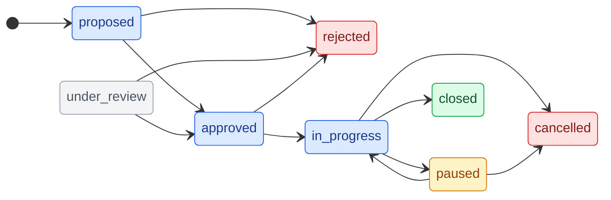

# Arquitectura del Backend

API REST construida con **NestJS 11** sobre **Node.js 26**, usando **Prisma 7**
(adaptador `pg`) y **PostgreSQL 15**. Los archivos se guardan en **RustFS** (S3).
La especificación OpenAPI se publica con Swagger.

Ver también: [Esquema de base de datos](./database_arch.md),
[Arquitectura del frontend](./frontend_arch.md) y el
[plan de SSO](./sso-plan.md).

## Resumen

| Aspecto        | Elección                                                   |
| -------------- | ---------------------------------------------------------- |
| Framework      | NestJS 11 (módulos, controllers, services, guards)         |
| Lenguaje       | TypeScript sobre Node.js 26                                |
| Base de datos  | PostgreSQL 15 vía Prisma 7 (adaptador `pg`)                |
| Almacenamiento | RustFS (S3-compatible) localmente y en producción          |
| Autenticación  | JWT HS256 (`@nestjs/jwt`) + hash de contraseñas con scrypt |
| Documentación  | Swagger / OpenAPI en `/api`                                |
| Pruebas        | Tests unitarios con Jest y e2e con Supertest               |

## Arranque

`src/main.ts` es el punto de entrada:

- Crea la app a partir de `AppModule`.
- Registra un `ValidationPipe` global (`whitelist` + `transform`), de modo que
  los campos desconocidos se eliminan y los DTOs se convierten a sus tipos.
- Publica Swagger en `/api`.
- Escucha en `PORT` (por defecto `3001`).

`AppModule` importa los módulos de dominio, carga las variables de entorno con
`ConfigModule` y aplica `LoggerMiddleware` a todos los controladores.

### Ciclo de vida de una petición

1. **LoggerMiddleware** asigna un `request-id` (reutiliza `x-request-id` o
   genera uno), lo devuelve en la respuesta y, al terminar, registra una línea
   JSON con método, ruta, status, duración y usuario.
2. Los **guards** (`AuthGuard`, `AdminGuard`) autentican y autorizan.
3. Los **pipes** validan y transforman el body/params en DTOs.
4. El **controller** despacha al método del service correspondiente.
5. El **service** aplica las reglas de negocio, llama a
   `AuthorizationService`, `PrismaService` y/o `StorageService`, y mapea el
   resultado.
6. La respuesta se serializa como JSON (o se envía como stream en descargas).

### Logging de peticiones

`LoggerMiddleware` emite una línea JSON por petición cuando termina la
respuesta, con `timestamp`, `level`, `requestId`, `method`, `path`, `status`,
`durationMs` y `userId` (`null` si es anónima). El nivel se deriva del status
(`5xx` → `error`, `4xx` → `warn`, resto → `log`) y solo se emite si alcanza
`LOG_LEVEL`. Las líneas `warn`/`error` van a stderr y el resto a stdout.

## Capas

| Capa                     | Responsabilidad                                                                            |
| ------------------------ | ------------------------------------------------------------------------------------------ |
| **Controller**           | Define rutas, valida DTOs y recibe al usuario autenticado. Delgado por diseño.             |
| **Guard**                | `AuthGuard` valida el token Bearer; `AdminGuard` exige el rol `admin`.                     |
| **Service**              | Lógica de negocio, reglas de estado y mapeo de respuestas. Un service por dominio.         |
| **AuthorizationService** | Centraliza las reglas de permisos (rol asignado en el proyecto, admin y directivo). |
| **PrismaService**        | Acceso a datos (cliente Prisma con adaptador `pg`).                                        |
| **StorageService**       | Abstracción de archivos; la implementación concreta es `S3StorageService`.                 |

Los services devuelven **tipos de respuesta propios** (`ProjectDetailResponse`,
etc.) en lugar de modelos crudos de Prisma, para no filtrar detalles de la base
de datos y mantener estable el contrato de la API aunque cambie el esquema.

## Módulos

| Módulo | Descripción |
| --- | --- |
| **Auth** | Registro público, login, gestión de usuarios y asignación de roles. Crea el primer admin. |
| **Projects** | CRUD de proyectos, asignación de actores y transición de estados. |
| **Observations** | Observaciones de texto libre asociadas a un proyecto. |
| **Milestones** | Entregables programados por proyecto. |
| **Attachments** | Subida, listado, descarga y borrado de archivos. |
| **Reports** | Entregas por proyecto, su contenido y su revisión. |
| **Rubrics** | Plantillas de rúbricas por área y asignación de una rúbrica por proyecto/fase. |
| **Evaluations** | Evaluación semestral del proyecto, notas ponderadas y bloqueo de fase/cierre. |
| **Stats** | KPIs para docentes, evaluadores, directivos y admin; panorama por semestre para admin/directivo. |
| **Storage** | Expone `StorageService` para el módulo de anexos (S3/RustFS). |

## Autenticación y autorización

El login (`POST /auth/login`) verifica la contraseña con **scrypt** (sal
aleatoria, clave de 64 bytes) y emite un **JWT HS256** firmado con
`@nestjs/jwt`, de 24 horas por defecto. Los usuarios sin contraseña local
(cuentas de SSO) no pueden entrar por esta vía. `AuthGuard` valida el header
`Authorization: Bearer <token>`, comprueba la firma y la expiración, y carga el
usuario en `request.user`. `GET /auth/me` devuelve el usuario autenticado, para
que el BFF hidrate la sesión.

La sesión se renueva de forma **deslizante**: cuando al token ya le pasó la
mitad de su vida, el guard firma uno nuevo y lo devuelve en el header
`x-access-token`; el BFF lo guarda en la cookie httpOnly sin obligar a
re-loguear. Las ventanas se ajustan con `AUTH_TOKEN_TTL_SECONDS` y
`AUTH_TOKEN_RENEW_AFTER_SECONDS`.

`PATCH /auth/me/password` permite cambiar la contraseña propia: valida la actual
con scrypt, exige mínimo 8 caracteres y que la nueva sea distinta. Si la actual
no coincide responde `400` (no `401`, para no cerrar la sesión global).

Roles globales (`UserRole`): `admin`, `directivo`, `evaluator`, `teacher`,
`proposer`, `student`. Roles dentro de un proyecto (`ActorRole`): `teacher`,
`evaluator`, `student`.

`teacher` unifica a los antiguos `coordinator` y `advisor`: agrupa al personal
docente que supervisa proyectos.

`directivo` es el rol de gestión académica: revisa cualquier proyecto sin
asignarse, edita sus datos, asigna actores, comenta, gestiona o revisa entregas
y resuelve las transiciones de la fase de propuesta. Sustituye al antiguo
`evaluator` global.

`evaluator` identifica a quienes evalúan la expo. No tiene acceso global: solo
actúa en los proyectos donde se le asigna el rol de proyecto `evaluator` y, en
ellos, conserva los permisos de revisión (hitos, entregas, fase y comentarios).

`proposer` identifica a los proponentes externos que se registran solos desde
`/register`. No es un `ActorRole`, así que no se les asigna como actores;
proponen proyectos y, como proponentes del proyecto, pueden editarlo mientras
siga en `proposed` (o en el legado `under_review`).

La asignación a un proyecto **licencia** el rol global una sola vez: un
`teacher` puede ser asignado como `teacher` o como `evaluator`; un `evaluator` o
un `directivo`, solo como `evaluator`; un `student`, solo como `student`.
Después de la asignación, los permisos dependen del rol en el proyecto, no del
rol global.

`AuthorizationService` responde preguntas como "¿puede este usuario crear un
proyecto?", "¿puede gestionar este proyecto?" o "¿puede asignar actores?",
combinando la asignación en el proyecto con el `admin` (que siempre pasa) y el
`directivo`, que revisa cualquier proyecto sin asignarse y, además, puede
asignar actores, comentar, gestionar o revisar entregas y resolver las
transiciones de la fase de propuesta sin estar asignado.

### Matriz de permisos

Leyenda: **público** = no requiere token, **miembro** = asignado al proyecto
con cualquier rol, **rol** = requiere al menos un rol global. El `admin` siempre
pasa.

| Acción | Público | admin | directivo | teacher (asignado) | evaluator (asignado) | student (asignado) |
| --- | :---: | :---: | :---: | :---: | :---: | :---: |
| Listar / ver proyectos | sí* | sí | sí | miembro | miembro | miembro + vista previa‡ |
| Ver privados aprobados (vista previa) | no | sí | sí | no | no | sí‡ |
| Expresar / retirar interés | no | no | no | no | no | sí‡ |
| Ver y gestionar estudiantes interesados | no | sí | sí | miembro (docente) | no | no |
| Crear proyecto | no | rol | rol | rol | rol | rol |
| Editar datos del proyecto | no | sí | sí | miembro | miembro | no† |
| Gestionar / borrar proyecto | no | sí | no | miembro | no | no |
| Asignar actores | no | sí | sí | miembro | no | no |
| Gestionar hitos | no | sí | no | miembro | miembro | no |
| Gestionar y revisar entregas | no | sí | sí | miembro | miembro | no |
| Preparar y enviar entregas | no | sí | no | no | no | miembro |
| Avanzar fase (semestre) | no | sí | no | miembro | no | no |
| Cambiar estado | no | sí | sí (propuesta)* | miembro (ejecución) | miembro (propuesta) | no |
| Ver observaciones / hitos / anexos | no | sí | sí | miembro | miembro | miembro |
| Comentar un proyecto | no | sí | sí | miembro | miembro | miembro |
| Ver evaluaciones y notas | no | sí | sí | no | miembro | no |
| Enviar evaluación semestral | no | sí | no | no | sí | no |
| Crear / editar plantillas de rúbricas | no | sí | sí | no | no | no |
| Asignar rúbrica a un proyecto/fase | no | sí | sí | no | no | no |
| Ver panorama por semestre | no | sí | sí | no | no | no |

- \* El `directivo` y el `evaluator` asignado resuelven las transiciones de la
  fase de propuesta (`proposed → approved`/`rejected`, el legado
  `under_review → approved`/`rejected` y `approved → rejected`); las
  transiciones de ejecución requieren estar asignado como `teacher`.
- `Crear proyecto` solo requiere que el usuario tenga al menos un rol global.
- `Listar / ver proyectos`: sin sesión solo los finalizados y no privados; con
  sesión, además los no privados en `approved`, `in_progress` o `paused`. El
  `directivo` ve todos; un `evaluator` sin asignación solo ve los públicos y los
  que propuso. Los estudiantes ven además los privados en `approved` con
  información limitada.
- ‡ Un estudiante con rol global `student` puede interesarse en un proyecto
  `approved` si no es su proponente ni ya está asignado. El interés lleva un
  mensaje opcional y se puede retirar; un docente, directivo o admin lo ve en la
  pestaña **Equipo** y puede asignar al estudiante (lo que elimina el interés) o
  descartarlo. El estudiante conserva la vista previa del privado mientras tenga
  interés, aunque el proyecto cambie de estado.
- `Editar datos del proyecto`: lo permiten `admin` y `directivo` (sin
  asignarse); un `teacher` o `evaluator` asignado al proyecto con su rol
  correspondiente. Un proyecto `closed` o `rejected` es de solo lectura
  (responde `409`). Cada campo modificado se registra en `ProjectChangeHistory`.
- El `directivo` ve todos los proyectos y, sin asignarse, puede editar sus
  datos, asignar actores, comentar, gestionar o revisar entregas y resolver la
  fase de propuesta. Para gestionar hitos o aprobar la fase necesita una
  asignación como `evaluator`; para avanzar de fase o hacer las transiciones de
  ejecución, una asignación como `teacher`.
- `Preparar y enviar entregas` (contenido y envío) queda reservado al `student`
  asignado o a un `admin`. Docentes, evaluadores, directivos y proponentes solo
  configuran y revisan la entrega, aunque estén asignados al proyecto.
- El `evaluator` de expo no tiene acceso global: solo participa en los
  proyectos donde se le asigna el rol de proyecto `evaluator`. En ellos conserva
  los permisos de revisión y aprobación de fase.
- Un `directivo` puede consultar las evaluaciones de cualquier proyecto y
  asignar la rúbrica de cada semestre, pero **no puede enviar la evaluación**
  salvo que también esté asignado como `evaluator`. El `admin` sí puede enviarla.
- † El `student` no edita los datos por su rol, pero el **proponente** (de
  cualquier rol global, incluido `student`) puede editar mientras el proyecto
  esté en `proposed` (o en el legado `under_review`).

Al arrancar, `AuthService` crea un admin inicial si la base de datos está vacía
y existen `INITIAL_ADMIN_EMAIL`, `INITIAL_ADMIN_PASSWORD` y
`INITIAL_ADMIN_NAME`.

## Ciclo de vida del proyecto

El camino feliz es:

```
proposed → approved → in_progress → closed
```

`under_review` quedó como **legado**: se conserva en el enum y en los proyectos
antiguos, que pueden salir del estado hacia `approved` o `rejected`, pero ya no
es un destino alcanzable. `rejected` es terminal y se alcanza desde la fase de
propuesta (`proposed`, el legado `under_review` o `approved`). `cancelled`
también es terminal y representa un proyecto que se canceló **después de haber
empezado** (desde `in_progress` o `paused`); `paused` suspende la ejecución y
permite reanudarla o cancelarla. Las transiciones se validan en
`ProjectsService`; cada cambio se registra en `ProjectStatusHistory` dentro de
una transacción, exige un motivo (salvo para `admin`) y respeta los permisos del
rol que realiza la transición.

| Desde                               | Siguientes estados permitidos   |
| ----------------------------------- | ------------------------------- |
| `proposed`                          | `approved`, `rejected`          |
| `under_review` (legado)             | `approved`, `rejected`          |
| `approved`                          | `in_progress`, `rejected`       |
| `in_progress`                       | `paused`, `closed`, `cancelled` |
| `paused`                            | `in_progress`, `cancelled`      |
| `closed` / `cancelled` / `rejected` | — (terminal)                    |

Los directivos y los evaluadores asignados gestionan las transiciones de la
fase de propuesta (`proposed → approved`/`rejected`, el legado `under_review`,
y `approved → rejected`); los docentes asignados gestionan el resto
(`approved → in_progress`, `in_progress → {paused, closed, cancelled}`,
`paused → {in_progress, cancelled}`).

### Fases (semestres) e hitos mínimos

La **fase** (`phase`, `semester_1` → `semester_2`) es independiente del estado:
un proyecto puede estar `in_progress` y avanzar de semestre sin cambiar de
estado. `POST /projects/:id/phase/advance` avanza la fase solo cuando el
proyecto está `in_progress`, todos los **hitos mínimos** de la fase actual (más
los globales, sin fase) están completos y el **visto bueno de fase** está
completo: el proponente del proyecto y cada evaluador asignado aprobaron la fase
destino con `POST /projects/:id/phase/approvals`. Si falta algo, responde `409`
con los pendientes. El bloqueo es duro, sin excepción para `admin`, y el avance
se registra en `ProjectChangeHistory` (`field = "phase"`). Cada aprobador puede
retirar su visto bueno con `DELETE /projects/:id/phase/approvals` mientras no se
haya avanzado.

Los **hitos mínimos** son los marcados con `isMinimum`. Son obligatorios para
avanzar de fase y para cerrar el proyecto: la transición `in_progress → closed`
también responde `409` mientras quede algún hito mínimo sin completar o la fase
actual no esté evaluada. La regla es un bloqueo duro, sin excepción para
`admin`. Rechazar un proyecto nunca se bloquea.

### Evaluación semestral

Cada proyecto tiene una **rúbrica asignada por fase** (`ProjectRubricAssignment`,
`projectId + phase`). Si no existe asignación se usa la plantilla de sistema
**“Nota general”**: un único criterio al 100%. Los directivos y administradores
crean plantillas; la asignación se hace desde la pestaña Evaluación del proyecto.

Cada evaluador asignado (o un admin) envía **una evaluación por fase** con:

- Una nota `0.0–5.0` por criterio.
- Un comentario opcional por criterio.
- Un comentario general opcional.
- La nota total ponderada se calcula en el backend y se guarda junto con un
  snapshot de los criterios (`ProjectEvaluationCriterion`).

La evaluación solo se puede crear o corregir mientras el proyecto está
`in_progress` y la fase evaluada es la actual. Para **avanzar de fase**, todos
los evaluadores asignados actualmente deben haber enviado la evaluación de la
fase actual; si no hay evaluadores asignados, se exige al menos una evaluación
(normalmente del admin). El cierre del proyecto exige la evaluación de la fase
actual. El bloqueo también aplica al `admin` y responde `409` con los nombres
pendientes. La evaluación del admin no sustituye a un evaluador asignado que
falte.

La asignación de rúbrica se bloquea en cuanto existe una evaluación de esa fase.
Una plantilla con evaluaciones no se puede editar y una plantilla asignada no se
puede archivar.

### Hitos y entregas

Un hito se puede vincular con una o varias **entregas** (`ProjectReport`) y una
entrega con varios hitos (tabla intermedia `MilestoneReportLink`). Al crear o
editar un hito se envía `reportIds` con las entregas a vincular (solo del mismo
proyecto). **Un hito no se puede completar** mientras alguna entrega vinculada
no esté `accepted`; la API responde `409` con las entregas pendientes. Volver a
marcarlo como pendiente siempre está permitido.

Eliminar un hito o una entrega solo borra sus enlaces: la otra parte no se toca.
La interfaz avisa antes de eliminarlos indicando qué se desvinculará.

Todo proyecto nuevo nace con el hito mínimo **«Documento final»** en
`semester_2`, con vencimiento a un año de la fecha de inicio (o de la fecha de
creación si no se indicó inicio), **más una entrega «Documento final»** de tipo
Archivo (PDF/Word, máximo 1 archivo) vinculada a él. Es el artículo/documento
final que cada grupo debe adjuntar y que debe ser aceptado para cerrar el
proyecto; el hito y la entrega se pueden editar o eliminar como cualquier otro.



## Modelo de datos

El esquema Prisma completo está documentado en
[database_arch.md](./database_arch.md). En resumen:

- **Usuario**: `User`, `UserRoleAssignment`.
- **Proyecto**: `Project`, `ProjectSchool`, `ProjectNaturalProposer`,
  `ProjectDeliverable`.
- **Equipo y seguimiento**: `ProjectActorAssignment`, `ProjectObservation`,
  `ProjectInterest`, `ProjectStatusHistory`, `ProjectChangeHistory`,
  `ProjectMilestones`, `MilestoneReportLink`.
- **Archivos**: `ProjectAttachment` (solo metadatos; el binario vive en
  S3/RustFS).

## Anexos

`AttachmentsController` recibe `multipart/form-data` mediante `FileInterceptor`
(almacenamiento en memoria). Límite de **10 MB** y lista blanca de MIME (PDF,
Word, Excel, PNG, JPEG). El service sube el archivo a S3 y, si falla el
registro en la base de datos, lo elimina para no dejar huérfanos. Las descargas
se envían como stream con el nombre original en el header `Content-Disposition`.

Los archivos vinculados a una entrega (`reportId` no nulo) se excluyen del
listado de Anexos y se sirven desde la pestaña Entregas.

## Entregas

Una entrega (`ProjectReport`) tiene un **tipo** fijo (`type`: `text`, `link` o
`file`) definido por el docente/evaluador asignado al crearla; solo se puede
cambiar mientras esté `pending` y no tenga contenido. Para el tipo Archivo
(`file`) también se eligen los MIME permitidos (`allowedMimeTypes`) y el máximo
de archivos (`maxFiles`), obligatorios al crear. El estudiante agrega
**contenido** (`ProjectReportContent`) que debe coincidir con ese `type` (el
backend rechaza con `400` cualquier `kind` distinto). Los textos y enlaces se
guardan en la propia fila (`textContent`, `url`, `label`); los archivos
(documentos, imágenes y videos) reutilizan `ProjectAttachment` (`attachmentId`) y
por tanto el mismo almacenamiento S3. El contenido solo se puede modificar
mientras la entrega esté `pending` o `rejected`; al enviarla se valida que tenga
al menos una pieza.

Cada entrega expone en la API los hitos a los que está vinculada
(`milestones`), y cada hito expone sus entregas vinculadas (`reports`) con su
estado. Ver [Hitos y entregas](#hitos-y-entregas).

`POST .../contents/files` (multipart, campo `file`) acepta documentos (PDF, Word,
Excel), imágenes (PNG, JPEG, WebP, GIF) y videos (MP4, WebM, OGG) hasta
`MAX_REPORT_FILE_SIZE_BYTES` (100 MB por defecto); valida que el MIME esté entre
los `allowedMimeTypes` de la entrega y que no se haya superado `maxFiles` (si no,
`409`), guarda el archivo en el almacenamiento por streaming y crea
`ProjectAttachment` + `ProjectReportContent` en una transacción. La subida pasa
por la API, así que el almacenamiento no necesita endpoint público ni CORS.
`GET .../contents/:cid/stream` sirve el archivo inline y reenvía la cabecera
`Range` a S3 para responder `206 Partial Content`, lo que permite reproducir y
buscar dentro de un video. Los objetos que quedan sin fila en la base de datos se
limpian con `npm run storage:gc`.

## Manejo de errores

Se usan las excepciones HTTP integradas de Nest, por lo que las respuestas
siguen una forma consistente (`statusCode`, `message`, `error`):

| Estado | Cuándo                                                              |
| ------ | ------------------------------------------------------------------- |
| `400`  | DTO inválido, transición de estado inválida o motivo faltante.      |
| `401`  | Token ausente, malformado o expirado.                               |
| `403`  | Autenticado pero sin rol/asignación en el proyecto.                 |
| `404`  | Proyecto, usuario, hito o anexo no encontrado.                      |
| `409`  | Valor único duplicado (por ejemplo email o asignación de actor).    |
| `500`  | Configuración requerida faltante (S3, secreto de auth).             |
| `503`  | La base de datos no está disponible (conexión rechazada o agotada). |

Los errores de conexión a PostgreSQL (`P1001`, `P1002`, `P1008`, `P1017` y
códigos del driver como `ECONNREFUSED`) se traducen a `503 Service Unavailable`
con la misma forma JSON mediante `DatabaseExceptionFilter`. El resto de errores
mantiene el manejo por defecto de Nest. El servicio arranca aunque la base de
datos esté caída: omite la creación del admin inicial y responde `503` en las
rutas que la necesitan.

## Configuración

| Variable                                                     | Propósito                                                                                        |
| ------------------------------------------------------------ | ------------------------------------------------------------------------------------------------ |
| `DATABASE_URL`                                               | Cadena de conexión a PostgreSQL.                                                                 |
| `AUTH_SECRET`                                                | Clave de firma HMAC (mínimo 32 caracteres).                                                      |
| `AUTH_TOKEN_TTL_SECONDS`                                     | Vida del token de acceso (86400 s por defecto).                                                  |
| `AUTH_TOKEN_RENEW_AFTER_SECONDS`                             | Antigüedad para reemitir el token en una petición válida (mitad del TTL por defecto).            |
| `INITIAL_ADMIN_*`                                            | Email, contraseña y nombre del admin inicial.                                                    |
| `MAX_FILE_SIZE_BYTES`                                        | Límite de tamaño de anexos (por defecto 10 MB).                                                  |
| `MAX_REPORT_FILE_SIZE_BYTES`                                 | Límite de tamaño de archivos de una entrega (100 MB por defecto).                                |
| `S3_ENDPOINT`, `S3_BUCKET`, `S3_ACCESS_KEY`, `S3_SECRET_KEY` | Almacenamiento de archivos.                                                                      |
| `S3_REGION`, `S3_FORCE_PATH_STYLE`                           | Ajustes del cliente S3 (`true` para RustFS/S3 path-style).                                       |
| `LOG_LEVEL`                                                  | Nivel mínimo del log de peticiones (`error`, `warn`, `log`/`info` o `debug`; `log` por defecto). |

## Semillas y migraciones

En `prisma/`:

- `schema.prisma` y `migrations/` — esquema y migraciones.
- `seed.ts` + `seed/` — datos de ejemplo por dominio.
- `fixtures/` — datos JSON y archivos de anexos.

Comandos: `npx prisma migrate dev`, `npm run seed` (y variantes como
`seed:users`, `seed:projects`, etc.).

## Mantenimiento

- `npm run storage:gc` — borra del almacenamiento los objetos sin
  `ProjectAttachment` (guardados que no llegaron a confirmarse). Flags:
  `--dry-run` y `--max-age-hours=N` (24 h por defecto). Entrada en
  `src/storage/gc-cli.ts`; lógica en `src/storage/storage-gc.service.ts`.

## Pruebas

- Tests unitarios: `npm test` (Jest, archivos `*.spec.ts` junto al código).
- Watch / cobertura: `npm run test:watch`, `npm run test:cov`.
- End-to-end: `npm run test:e2e` (Supertest).

## Endpoints principales

| Método | Ruta | Descripción |
| --- | --- | --- |
| `GET` | `/health` | Sonda pública: `200` si la base de datos responde, `503` si no. |
| `POST` | `/auth/register` | Registro público de un proponente; crea la cuenta con rol `proposer` y devuelve usuario + token (público). |
| `POST` | `/auth/login` | Iniciar sesión y recibir un token de acceso (público). |
| `GET` | `/auth/me` | Usuario autenticado actual (lo usa el BFF para hidratar la sesión). |
| `GET/POST` | `/auth/users` | Listar / crear usuarios (admin). |
| `PATCH` | `/auth/users/:id/roles` | Reemplazar los roles de un usuario (admin). |
| `PATCH` | `/auth/me/password` | Cambiar la contraseña propia (valida la actual; `400` si no coincide o si la nueva es igual). |
| `GET` | `/projects` | Listar los proyectos visibles para el solicitante (sin sesión: solo finalizados y no privados; con sesión: además los no privados aprobados o en ejecución; los estudiantes ven los privados aprobados en vista previa). |
| `GET` | `/projects/mine` | Proyectos propuestos y asignados al usuario. |
| `GET` | `/projects/mine/interests` | Proyectos en los que el usuario expresó interés. |
| `GET` | `/projects/:id` | Detalle (404 si el proyecto es privado y el solicitante no es miembro; los estudiantes ven los aprobados en vista previa). Incluye `evaluationGate` para miembros y `viewerInterest`/`canExpressInterest` para estudiantes. |
| `POST` | `/projects/:id/interests` | Expresar interés en un proyecto aprobado con mensaje opcional (estudiante, no proponente ni asignado). Devuelve el detalle actualizado. |
| `DELETE` | `/projects/:id/interests/me` | Retirar el interés propio (`204`). |
| `GET` | `/projects/:id/interests` | Listar estudiantes interesados (admin, directivo o docente asignado). |
| `DELETE` | `/projects/:id/interests/:interestId` | Descartar un interés (admin, directivo o docente asignado; `204`). |
| `POST` | `/projects` | Crear un proyecto; `isPrivate` lo define el proponente. |
| `PUT` | `/projects/:id` | Editar los datos (admin, directivo o docente/evaluador asignado; proponente mientras siga en propuesta; `409` si está finalizado/rechazado). Registra historial por campo. |
| `DELETE` | `/projects/:id` | Borrar (admin o docente asignado). |
| `PATCH` | `/projects/:id/status` | Cambiar estado (registra historial; `under_review` solo como legado). El cierre exige hitos mínimos completos y evaluación de la fase actual. |
| `POST` | `/projects/:id/phase/advance` | Avanzar de fase (semestre) si los hitos mínimos están completos, la fase está evaluada y el proponente y los evaluadores dieron su visto bueno (`409` si no). |
| `POST` | `/projects/:id/phase/approvals` | Dar el visto bueno de fase (proponente o evaluador asignado). |
| `DELETE` | `/projects/:id/phase/approvals` | Retirar el visto bueno de fase propio. |
| `POST` | `/projects/:id/actors` | Asignar un usuario a un proyecto. |
| `GET/POST` | `/projects/:id/observations` | Listar / agregar observaciones. |
| `GET/POST/PATCH/DELETE` | `/projects/:id/milestones` | Gestionar hitos: marca de mínimo (`isMinimum`), fase y entregas vinculadas (`reportIds`). |
| `GET/POST/DELETE` | `/projects/:id/attachments` | Gestionar anexos. |
| `GET` | `/projects/:id/attachments/:aid/download` | Descargar un anexo. |
| `GET/POST/PATCH/DELETE` | `/projects/:id/reports` | Gestionar entregas y su contenido. |
| `POST` | `/projects/:id/reports/:rid/submit` | Enviar una entrega con contenido. |
| `POST` | `/projects/:id/reports/:rid/review` | Aceptar o rechazar una entrega. |
| `POST/PATCH/DELETE` | `/projects/:id/reports/:rid/contents[/:cid]` | Añadir, editar o borrar contenido de la entrega. |
| `POST` | `/projects/:id/reports/:rid/contents/files` | Sube un archivo de entrega (multipart) y lo registra como contenido. |
| `GET` | `/projects/:id/reports/:rid/contents/:cid/stream` | Ver o reproducir el archivo inline, con `Range`. |
| `GET` | `/rubrics/templates` | Listar plantillas de rúbricas (admin/directivo). |
| `POST` | `/rubrics/templates` | Crear una plantilla; los porcentajes deben sumar 100 (admin/directivo). |
| `GET/PATCH` | `/rubrics/templates/:id` | Consultar o editar una plantilla (admin/directivo). |
| `PATCH` | `/rubrics/templates/:id/archive` | Archivar una plantilla no asignada (admin/directivo). |
| `PUT` | `/projects/:id/rubric-assignments/:phase` | Asignar una plantilla a un proyecto/fase (admin/directivo). |
| `DELETE` | `/projects/:id/rubric-assignments/:phase` | Volver a la rúbrica general (admin/directivo). |
| `GET` | `/projects/:id/evaluations` | Rúbricas, evaluaciones, promedio y evaluadores pendientes (admin, directivo o evaluador asignado). |
| `PUT` | `/projects/:id/evaluations/:phase` | Crear o actualizar la evaluación propia (admin o evaluador asignado). |
| `GET` | `/stats/kpis` | Indicadores agregados: pendientes, distribución de proyectos y actividad de revisión (admin, directivo, docente o evaluador; el alcance es global para admin/directivo y los proyectos asignados o propuestos para el resto). |
| `GET` | `/stats/semesters` | Panorama global por semestre: proyectos, aceptación, hitos mínimos y entregas por semestre académico y por fase del proyecto (admin/directivo). |

La autenticación es **global** (`AuthGuard` como `APP_GUARD`): todas las rutas
requieren token salvo las marcadas con `@Public()` (`/health`, `/auth/register`,
`/auth/login`, `GET /projects` y `GET /projects/:id`). En las rutas públicas el
token es opcional: si llega, se resuelve el usuario y se adaptan los datos
mostrados, y si es inválido se responde `401` en lugar de degradar a anónimo.

### Visibilidad de proyectos

`AuthorizationService` concentra las reglas:

- `projectVisibilityWhere(viewer)` construye el `where` de Prisma del listado y
  el detalle: para visitantes anónimos, público es `isPrivate = false` y estado
  `closed`; para usuarios autenticados, además los no privados en `approved`,
  `in_progress` o `paused`. A eso se suman `proposerUserId`, las asignaciones y
  los intereses del solicitante; los roles `admin` y `directivo` ven todo. Los
  estudiantes ven además los privados en `approved` en modo de vista previa.
- `assertProjectMember` (usado por observaciones, hitos, anexos y entregas) es
  de miembros: proponente, actores asignados y roles revisores. Los proyectos
  públicos solo exponen su información base en el listado y el detalle. La vista
  previa de un privado expone aún menos: nombre, estado, fase, fuente, ubicación,
  descripción, requisitos de equipo y resultados esperados.
- `canExpressInterest` exige rol global `student`, proyecto `approved`, y que el
  solicitante no sea el proponente ni un actor asignado. El interés duplicado y
  el estado se validan en `ProjectsService`.
